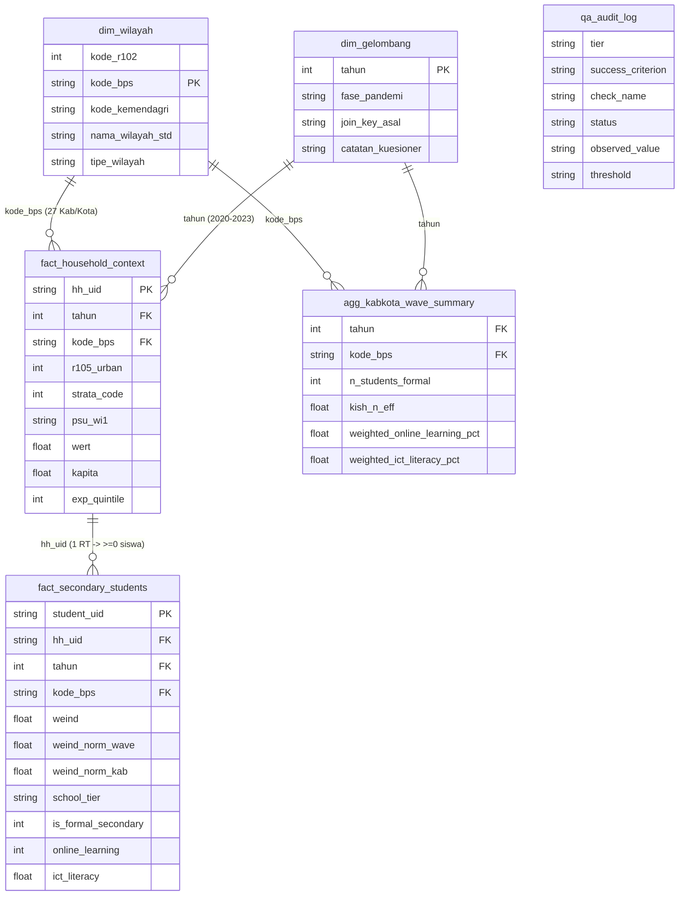

# Panduan Navigasi, Kamus Istilah, dan Referensi Formula Repositori Data (`J2-T1`)

**Proyek:** *The Post-Pandemic Digital Learning Divide: Multilevel Determinants of Online Learning Participation and ICT Literacy Among Secondary Students in West Java*  
**Sumber Primer:** SUSENAS Maret `2020, 2021, 2022, 2023` Provinsi Jawa Barat (Badan Pusat Statistik / BPS RI)  
**Status Audit:** `13/13` Pemeriksaan QA Gate **PASS** (`102.538` Rumah Tangga | `29.802` Siswa Menengah | `27` Kab/Kota)

Dokumen tunggal ini berfungsi sebagai **pusat navigasi utama, kamus istilah, kamus kolom lengkap (`96` kolom pada `6` tabel), serta referensi rumus hitung** bagi seluruh pengguna repositori `data/`.

---

## Daftar Isi Cepat
1. [Peta Navigasi Kebutuhan Data (*Saya butuh apa $\rightarrow$ Pakai mana?*)](#1-peta-navigasi-kebutuhan-data)
2. [Daftar Berkas di Repositori `data/`](#2-daftar-berkas-di-repositori-data)
3. [Arsitektur Relasional & Diagram ERD (6 Tabel)](#3-arsitektur-relasional--diagram-erd-6-tabel)
4. [Kamus Istilah Statistik, Desain Survei, & Crosswalk](#4-kamus-istilah-statistik-desain-survei--crosswalk)
5. [Kamus Kolom Lengkap, Definisi Operasional, & Rumus Hitung (Semua 6 Tabel)](#5-kamus-kolom-lengkap-definisi-operasional--rumus-hitung)
   - [5.1 Tabel `fact_secondary_students` (47 Kolom — Tabel Inti)](#51-tabel-fact_secondary_students-47-kolom)
   - [5.2 Tabel `fact_household_context` (20 Kolom — Konteks Populasi RT)](#52-tabel-fact_household_context-20-kolom)
   - [5.3 Tabel `agg_kabkota_wave_summary` (14 Kolom — Agregat Wilayah)](#53-tabel-agg_kabkota_wave_summary-14-kolom)
   - [5.4 Tabel `dim_wilayah` (5 Kolom) & `dim_gelombang` (4 Kolom)](#54-tabel-dim_wilayah-5-kolom--dim_gelombang-4-kolom)
   - [5.5 Tabel `qa_audit_log` (6 Kolom — Bukti Pemeriksaan QA)](#55-tabel-qa_audit_log-6-kolom)
6. [Quickstart Kode Siap Pakai (Python, R, SQL) & Verifikasi Checksum](#6-quickstart-kode-siap-pakai-python-r-sql)
7. [Keterbatasan Data, Etika, & Atribusi BPS RI](#7-keterbatasan-data-etika--atribusi-bps-ri)

---

## 1. Peta Navigasi Kebutuhan Data

| Kebutuhan Riset / Analisis Anda | Berkas / Tabel Tujuan | Filter & Kolom Wajib |
| :--- | :--- | :--- |
| **Memodelkan tren *Online Learning* 4 tahun (`2020–2023`, Track A)** | `fact_secondary_students.csv` *(atau tabel SQLite sama)* | `in_track_a_formal = 1` (`28.556` siswa); Outcome: `online_learning`; Bobot: `weind` (deskriptif) / `weind_norm_kab` atau `weind_norm_wave` (multilevel) |
| **Memodelkan *ICT Literacy* (`R812`) & Negeri/Swasta (`2022–2023`, Track B)** | `fact_secondary_students.csv` | `in_track_b_formal = 1` (`14.063` siswa); Outcome: `ict_literacy` & `online_learning`; Prediktor tambahan: `school_sector` |
| **Membuat peta koroplet / tabel tren `27` Kab/Kota $\times$ `4` tahun** | `agg_kabkota_wave_summary.csv` | Langsung pakai (`108` sel lengkap): `kode_bps`, `weighted_online_learning_pct`, `weighted_ict_literacy_pct`, `ol_se_pct`, `kish_n_eff` |
| **Uji sensitivitas dengan siswa jalur kesetaraan/SLB (`Paket B/C`, `SMPLB/SMLB`)** | `fact_secondary_students.csv` | Gunakan seluruh `29.802` baris tanpa filter `is_formal_secondary = 1`; opsional filter `is_typical_age_11_19 = 1` |
| **Uji sensitivitas membatasi usia remaja lazim (`11–19` thn)** | `fact_secondary_students.csv` | Tambahkan syarat `is_typical_age_11_19 = 1` (`28.190` siswa formal) |
| **Analisis seluruh rumah tangga Jawa Barat / hitung ulang garis kemiskinan** | `fact_household_context.csv.gz` | Seluruh `102.538` RT sampel Jabar (`2020–2023`), kolom `kapita`, `wert`, `exp_quintile` |
| **Query SQL relasional / integrasi langsung R & Python** | `master_j2_t1_digital_learning.sqlite` | Hubungkan lewat `sqlite3` (Python), `RSQLite` (R), atau `DB Browser for SQLite` |
| **Membaca kamus kolom secara terprogram (*machine-readable*)** | `CODEBOOK.csv` | `96` entri kolom lengkap lintas 6 tabel |

---

## 2. Daftar Berkas di Repositori `data/`

| Berkas | Format | Cakupan | Deskripsi |
| :--- | :--- | :---: | :--- |
| **`README.md`** *(file ini)* | Markdown | — | **Satu-satunya panduan navigasi**, kamus istilah, definisi operasional, dan rumus seluruh kolom. |
| **`master_j2_t1_digital_learning.sqlite`** | SQLite 3 | 6 tabel terindeks | Master Database relasional utama (*Single Source of Truth*). |
| **`fact_secondary_students.csv`** | CSV (UTF-8) | `29.802` baris | Mart siswa menengah (`28.556` formal + `1.246` non-formal/SLB). |
| **`fact_household_context.csv.gz`** | Gzipped CSV | `102.538` baris | Mart seluruh rumah tangga sampel Jawa Barat (`2020–2023`). |
| **`agg_kabkota_wave_summary.csv`** | CSV (UTF-8) | `108` baris | Ringkasan terboboti `27 Kab/Kota x 4 Tahun`. |
| **`CODEBOOK.csv`** | CSV (UTF-8) | `96` baris | Kamus metadata kolom *machine-readable* (`table_name`, `column_name`, `role`, `waves_available`, dll.). |
| **`qa_audit_report.md`** | Markdown | — | Hasil 13 pengujian QA otomatis (`13/13 PASS`) dan statistik deskriptif awal. |
| **`manifest.json`** | JSON | — | Metadata paket data berstandar FAIR (jumlah baris, atribusi, status anonimisasi, ukuran byte). |
| **`checksums_sha256.txt`** | Text | — | Daftar *hash* `SHA-256` untuk validasi keutuhan berkas pasca-pengunduhan. |
| **`examples/quickstart_explore.py`** | Python | — | Skrip verifikasi checksum otomatis + tabel gradien perangkat & Kab/Kota. |
| **`examples/quickstart_multilevel.R`** | R | — | Template starter pemodelan `survey::svydesign` + `lme4::glmer` (Model 0 & Model 4). |

---

## 3. Arsitektur Relasional & Diagram ERD (6 Tabel)



---

## 4. Kamus Istilah Statistik, Desain Survei, & Crosswalk

* **Repeated Cross-Section:** Desain survei di mana sampel rumah tangga diundi ulang oleh BPS pada tiap gelombang Maret (`2020, 2021, 2022, 2023`). Individu yang sama **tidak** diikuti secara longitudinal antar tahun; pengamatan siswa bersarang dalam wilayah dan gelombang.
* **Track A (`2020–2023`):** Rangkaian 4 gelombang untuk meneliti dinamika *Online Learning* (`online_learning`) melintasi awal pandemi (Maret 2020), puncak PJJ (2021), transisi hybrid (2022), hingga pasca-pandemi (2023). Sampel formal: $N = 28.556$ siswa.
* **Track B (`2022–2023`):** Rangkaian 2 gelombang pasca-pandemi untuk meneliti secara paralel *Online Learning* (`online_learning`) dan *ICT Literacy* (`ict_literacy`, `R812`), termasuk perbedaan sektor sekolah Negeri vs Swasta (`school_sector`, `R611`). Sampel formal: $N = 14.063$ siswa.
* **Primary Sampling Unit (`PSU / WI1`) & `STRATA`:** SUSENAS menggunakan penarikan sampel klaster bertingkat (*two-stage stratified sampling*). Unit klaster tahap pertama (`PSU`) dalam file diseminasi identik 1-ke-1 dengan `WI1` (`2.591–2.603` klaster/tahun). Strata desain (`47` strata: `18` Kabupaten $\times$ `2` urban/rural + `2` Kota yang memiliki desa/kota $\times$ `2` + `7` Kota murni urban $\times$ `1`) direkonstruksi secara eksak melalui kombinasi `(R102, R105)` karena kolom `STRATA` tidak disertakan pada CSV `2023`.
* **Survey Weight (`weind`, `wert`) & Skala Bobot Multilevel:** `weind` (`FWT` pada `KOR IND1`) adalah kebalikan peluang pemilihan yang dikalibrasi ke proyeksi penduduk (`~49,78–51,04 juta` jiwa Jabar). Untuk model regresi multilevel, `weind` mentah tidak boleh dimasukkan begitu saja karena ukuran sampel efektif akan terbaca puluhan juta; gunakan bobot terskala (`weind_norm_wave` atau `weind_norm_kab` mengikuti **Carle, 2009 Method A**).
* **Kish Effective Sample Size ($N_{\text{eff}}$) & Design Effect ($\text{DEFF}_{\text{Kish}}$):** Pengukuran kehilangan presisi akibat ketidaksamaan bobot sampling. Nilai $\text{DEFF}_{\text{Kish}} = 1{,}660$ pada gabungan Track A berarti $28.556$ siswa sampel setara dengan $17.199{,}2$ sampel acak sederhana.
* **Singular Fit & Pilihan Model 2-Level vs 3-Level:** Hasil audit menunjukkan **`90,20%`** rumah tangga beranak sekolah menengah hanya memiliki `1` siswa menengah (hanya `9,80%` yang memiliki $\ge 2$ siswa). Memaksa random intercept tingkat rumah tangga (3-level) berisiko menghasilkan varians level-RT nol (*singular fit*), sehingga disarankan memakai **model 2-level (`Siswa -> 27 Kab/Kota`)** dengan efek gelombang dan *cluster-robust standard error* di tingkat `psu_wi1`.
* **Crosswalk Kuesioner SUSENAS (`2020–2023`):**
  * **Online Learning:** Berkode `R811_B` (*proses pembelajaran*) pada `2020–2021`, lalu bergeser ke `R811_H` (*pembelajaran online*) pada `2022–2023`. *(Peringatan: di `2020–2021`, `R811_H` adalah e-banking!).*
  * **Status Sekolah & Jenjang:** `R612` & `R613` (`2020–2021`) bergeser menjadi `R610` & `R612` (`2022–2023`).
  * **Anomali KIP & PIP di `2022`:** Di `2020–2021`, `KIP=R616` dan `PIP=R617`. Di `2022`, BPS menyisipkan pertanyaan *subsidi kuota internet* pada `R615`, sehingga `KIP=R616` dan `PIP=R617`. Di `2023`, `KIP=R615` dan `PIP=R616`. Seluruh pergeseran ini sudah ditangani otomatis dalam kolom `has_kip` dan `has_pip`.

---

## 5. Kamus Kolom Lengkap, Definisi Operasional, & Rumus Hitung

### 5.1 Tabel `fact_secondary_students` (`47` Kolom)
File CSV: `fact_secondary_students.csv` (`29.802` baris: `28.556` siswa formal + `1.246` non-formal/SLB).

#### A. Identifikasi, Geografi, & Desain Survei (`9` kolom)
| Kolom | Tipe | Definisi Operasional | Sumber SUSENAS & Rumus / Aturan Hitung |
| :--- | :--- | :--- | :--- |
| `student_uid` | `TEXT` | Kunci primer (*Primary Key*) unik per siswa lintas tahun. | `"{tahun}_{hh_id}_{R401}"` |
| `hh_uid` | `TEXT` | Kunci tamu (*Foreign Key*) ke `fact_household_context`. | `"{tahun}_{RENUM}"` (`2020–21`) atau `"{tahun}_{URUT}"` (`2022–23`) |
| `tahun` | `INTEGER` | Gelombang survei SUSENAS bulan Maret. | `{2020, 2021, 2022, 2023}` |
| `kode_bps` | `TEXT` | Kode standar BPS 4-digit Kab/Kota di Jawa Barat (`3201–3279`). | `"32" + pad2(R102)` |
| `nama_wilayah_std` | `TEXT` | Nama resmi Kabupaten/Kota huruf kapital sesuai Kemendagri. | Join dari `dim_wilayah` melalui `kode_bps` |
| `tipe_wilayah` | `TEXT` | Kategori administratif daerah (`KABUPATEN` vs `KOTA`). | Join dari `dim_wilayah` |
| `r105_urban` | `INTEGER` | Indikator tempat tinggal Perkotaan (`1`) vs Perdesaan (`0`). | `1` jika `R105 == '1'`, else `0` |
| `strata_code` | `INTEGER` | Kode 47 strata desain sampel (`11` s.d. `792`). | `int(R102) * 10 + int(R105)` *(rekonstruksi 1:1 `STRATA`)* |
| `psu_wi1` | `TEXT` | Pengenal klaster *Primary Sampling Unit* per gelombang. | `"{tahun}_{WI1}"` *(terverifikasi 1:1 dengan `PSU`)* |

#### B. Bobot Survei Kompleks (`5` kolom)
| Kolom | Tipe | Definisi Operasional | Rumus Matematis |
| :--- | :--- | :--- | :--- |
| `weind` | `REAL` | Bobot ekspansi individu (*individual sampling weight*). | $\text{FWT}_{\text{KOR IND1}}$ (`> 0`; $\sum \text{weind}$ = populasi Jabar) |
| `weind_norm_wave` | `REAL` | Bobot individu ternormalisasi dengan rata-rata `1.0` pada tiap gelombang `t`. | $w_{i,t}^{\text{norm\_wave}} = \dfrac{w_{i,t}}{\frac{1}{n_t}\sum_{j \in t} w_{j,t}}$ |
| `weind_norm_kab` | `REAL` | Bobot terskala di dalam klaster `(tahun, kode_bps)` (Carle 2009 Method A). | $w_{i,k,t}^{\text{norm\_kab}} = \dfrac{w_{i,k,t}}{\frac{1}{n_{k,t}}\sum_{j \in (k,t)} w_{j,k,t}}$ |
| `weind_trim_p99` | `REAL` | Bobot ekspansi yang di-*winsorize* pada persentil ke-99 tiap gelombang `t`. | $w_{i,t}^{\text{trim}} = \min\!\left(w_{i,t},\, Q_{0.99}(w_t)\right)$ |
| `weind_trim_norm_wave` | `REAL` | Bobot hasil *trimming* P99 yang dinormalisasi (`mean = 1.0` per tahun). | $w_{i,t}^{\text{trim\_norm}} = \dfrac{w_{i,t}^{\text{trim}}}{\frac{1}{n_t}\sum_{j \in t} w_{j,t}^{\text{trim}}}$ |

#### C. Demografi Siswa & Karakteristik Pendidikan (`9` kolom)
| Kolom | Tipe | Definisi Operasional | Sumber & Aturan Pemetaan |
| :--- | :--- | :--- | :--- |
| `age` | `INTEGER` | Umur individu dalam tahun (`11–53` thn seluruh jalur; `11–26` thn formal). | `int(R407)` |
| `female` | `INTEGER` | Jenis kelamin siswa (`1` = Perempuan, `0` = Laki-laki). | `1` jika `R405 == '2'`, else `0` |
| `school_level` | `TEXT` | Jenjang terperinci (`SMP`, `MTs`, `SMA`, `MA`, `SMK`, `MAK`, `Paket B`, `Paket C`, `SMPLB`, `SMLB`). | `R613` (`20–21`: `5..14`) / `R612` (`22–23`: `6..17`) bagi `masih bersekolah == '2'` |
| `school_tier` | `TEXT` | 3 kelompok jalur menengah (`Junior_Secondary`, `Senior_General`, `Senior_Vocational`). | `SMP/MTs/Paket B/SMPLB` $\rightarrow$ `Junior_Secondary`; `SMA/MA/Paket C/SMLB` $\rightarrow$ `Senior_General`; `SMK/MAK` $\rightarrow$ `Senior_Vocational` |
| `is_formal_secondary` | `INTEGER` | Flag siswa pendidikan formal (`1`) vs jalur non-formal/SLB (`0`). | `1` jika `school_level ∈ {SMP, MTs, SMA, MA, SMK, MAK}`, else `0` |
| `is_typical_age_11_19` | `INTEGER` | Flag rentang usia sekolah menengah lazim (`11–19` tahun). | `1` jika $11 \le \text{age} \le 19$, else `0` |
| `school_sector` | `TEXT` | Sektor penyelenggara sekolah (`Negeri`, `Swasta`, atau `NULL` di 2020–2021). | `R611` (`2022–2023`: `'1'` $\rightarrow$ `Negeri`, `'2'` $\rightarrow$ `Swasta`; `NULL` di `20–21`) |
| `has_kip` | `INTEGER` | Kepemilikan Kartu Indonesia Pintar (`1` = Ya, `0` = Tidak). | `1` jika `kip_col ∈ {'1','2'}` (`R616` di `20–22`, `R615` di `23`) |
| `has_pip` | `INTEGER` | Penerima Program Indonesia Pintar dalam setahun terakhir (`1` = Ya, `0` = Tidak). | `1` jika `pip_col == '1'` (`R617` di `20–22`, `R616` di `23`) |

#### D. Variabel Outcome & Akses Perangkat/Internet TIK (`13` kolom)
| Kolom | Tipe | Definisi Operasional | Sumber & Rumus / Aturan Hitung |
| :--- | :--- | :--- | :--- |
| `online_learning` | `INTEGER` | **Outcome Y1 (`2020–2023`):** Menggunakan internet untuk pembelajaran (3 bln terakhir). | `1` jika `R811_B == 'B'` (`20–21`) atau `R811_H == 'H'` (`22–23`), else `0` |
| `ict_literacy` | `REAL` | **Outcome Y2 (`2022–2023`):** Pernah belajar/mengikuti pelatihan TIK (`NULL` di `20–21`). | `1` jika `R812 == '1'`, `0` jika `R812 == '5'` (`2022–2023`), else `NULL` |
| `uses_phone` | `INTEGER` | Menggunakan telepon seluler dalam 3 bulan terakhir (`1`/`0`). | `1` jika `R801 == '1'`, else `0` |
| `owns_phone` | `INTEGER` | Memiliki atau menguasai telepon seluler (`1`/`0`). | `1` jika `R802 == '1'`, else `0` |
| `uses_pc_desktop` | `INTEGER` | Menggunakan komputer desktop/PC dalam 3 bulan terakhir (`1`/`0`). | `1` jika `R807_A == 'A'`, else `0` |
| `uses_laptop` | `INTEGER` | Menggunakan laptop/notebook dalam 3 bulan terakhir (`1`/`0`). | `1` jika `R807_B == 'B'`, else `0` |
| `uses_tablet` | `INTEGER` | Menggunakan komputer tablet dalam 3 bulan terakhir (`1`/`0`). | `1` jika `R807_C == 'C'`, else `0` |
| `has_computer_device` | `INTEGER` | Menggunakan minimal salah satu perangkat komputasi layar besar (`1`/`0`). | $\max(\text{uses\_pc\_desktop},\, \text{uses\_laptop},\, \text{uses\_tablet})$ |
| `device_tier` | `TEXT` | Tingkatan akses perangkat individu (`PC_Laptop_Tablet`, `HP_Only`, `None`). | `PC_Laptop_Tablet` jika `has_computer_device=1`; else `HP_Only` jika `uses_phone=1` atau `owns_phone=1`; else `None` |
| `uses_internet` | `INTEGER` | Pernah mengakses internet dalam 3 bulan terakhir (`1`/`0`). | `1` jika `R808 == '1'`, else `0` |
| `internet_via_hp` | `INTEGER` | Mengakses internet menggunakan HP/ponsel (`1`/`0`). | `1` jika `R809_D == 'D'`, else `0` |
| `internet_at_home` | `INTEGER` | Mengakses internet di rumah sendiri (`1`/`0`). | `1` jika `R810_A == 'A'`, else `0` |
| `internet_at_school` | `INTEGER` | Mengakses internet di gedung sekolah/kampus (`1`/`0`). | `1` jika `R810_D == 'D'`, else `0` |

#### E. Konteks Ekonomi Rumah Tangga & Flag Analitik (`11` kolom)
| Kolom | Tipe | Definisi Operasional | Sumber & Rumus Hitung |
| :--- | :--- | :--- | :--- |
| `kapita` | `REAL` | Pengeluaran per kapita sebulan rumah tangga siswa (Rupiah). | `KAPITA` dari `KP 4.3` ($= \text{EXPEND} / \text{R301}$) |
| `log_kapita` | `REAL` | Logaritma natural pengeluaran per kapita. | $\ln(\text{kapita})$ |
| `exp_quintile` | `INTEGER` | Kuintil kesejahteraan rumah tangga (`1` = 20% termiskin s.d. `5` = 20% terkaya). | Dihitung atas seluruh RT populasi per tahun (lihat rumus pada `fact_household_context`) |
| `hh_size` | `INTEGER` | Banyaknya anggota rumah tangga (`R301`). | `int(R301)` |
| `krt_female` | `INTEGER` | Kepala Rumah Tangga (`R403 == '1'`) berjenis kelamin perempuan (`1`/`0`). | `1` jika `R405 == '2'` pada KRT |
| `krt_edu_cat` | `TEXT` | Tingkat ijazah tertinggi KRT (`No_Primary`, `Primary_SD`, `Junior_SMP`, `Senior_SMA_SMK`, `Tertiary_Univ`). | Harmonisasi `R615` (`20–21`: `1..22`) & `R614` (`22–23`: `1..25`) pada `R403=='1'` |
| `rt_has_computer_r2001f` | `INTEGER` | Kepemilikan aset komputer/laptop di rumah tangga (`1`/`0`). | `1` jika `R2001F == '1'` di `KOR RT`, else `0` |
| `has_pkh` | `INTEGER` | Rumah tangga saat ini tercatat menerima Program Keluarga Harapan (`1`/`0`). | `1` jika `R2204A == '1'` di `KOR RT`, else `0` |
| `n_sec_students_in_hh` | `INTEGER` | Jumlah siswa menengah yang tinggal pada `hh_uid` yang sama. | $\text{COUNT}(\text{student\_uid}) \text{ GROUP BY } \text{hh\_uid}$ |
| `in_track_a_formal` | `INTEGER` | Flag inklusi sampel utama Track A (`2020–2023`, `28.556` baris). | `is_formal_secondary == 1` |
| `in_track_b_formal` | `INTEGER` | Flag inklusi sampel utama Track B (`2022–2023`, `14.063` baris). | `(is_formal_secondary == 1) AND (tahun ∈ {2022, 2023})` |

*(Catatan: `9` identitas + `5` bobot + `9` demografi/pendidikan + `13` TIK/outcome + `11` konteks/flag = tepat `47` kolom).*

---

### 5.2 Tabel `fact_household_context` (`20` Kolom)
File CSV: `fact_household_context.csv.gz` (`102.538` baris seluruh RT Jawa Barat `2020–2023`).

* **Kolom yang identik definisinya dengan `fact_secondary_students` (`14` kolom):** `hh_uid` (PK), `tahun`, `kode_bps`, `r105_urban`, `strata_code`, `psu_wi1`, `hh_size`, `kapita`, `log_kapita`, `exp_quintile`, `krt_female`, `krt_edu_cat`, `rt_has_computer_r2001f`, `has_pkh`.
* **Kolom khusus konteks RT (`6` kolom — total `14 + 6 = 20` kolom):**

| Kolom | Tipe | Definisi Operasional | Sumber & Rumus Hitung |
| :--- | :--- | :--- | :--- |
| `wert` | `REAL` | Bobot ekspansi rumah tangga (`WERT` di `KP 4.3`). | $\text{WERT}$ (`> 0`; digunakan sbg bobot penghitung `exp_quintile`) |
| `weind_hh_sum` | `REAL` | Total bobot ekspansi penduduk dalam RT (`WEIND` di `KP 4.3`). | $\text{WEIND}_{\text{KP 4.3}} = \text{wert} \times \text{hh\_size}$ |
| `food` | `REAL` | Rata-rata pengeluaran makanan rumah tangga sebulan (Rupiah). | `FOOD` dari `KP 4.3` |
| `nonfood` | `REAL` | Rata-rata pengeluaran bukan makanan rumah tangga sebulan (Rupiah). | `NONFOOD` dari `KP 4.3` |
| `expend` | `REAL` | Total pengeluaran rumah tangga sebulan (Rupiah). | `EXPEND` dari `KP 4.3` ($= \text{food} + \text{nonfood}$) |
| `electric_light` | `INTEGER` | Sumber penerangan utama RT berupa listrik PLN/Non-PLN (`1`/`0`). | `1` jika `R1816 ∈ {'1', '2'}`, else `0` |

* **Rumus Kuintil Terboboti `exp_quintile`:** Untuk setiap tahun $t$, seluruh $N_t$ rumah tangga diurutkan menurut `kapita` naik. Pangsa bobot kumulatif ke-$r$ dihitung sebagai $C_r = \frac{\sum_{m=1}^{r} \text{wert}_m}{\sum_{m=1}^{N_t} \text{wert}_m}$, lalu:
  $$\text{exp\_quintile}_r = \min\!\left(5,\; \max\!\left(1,\; \lfloor 5\, C_r - 10^{-12} \rfloor + 1\right)\right)$$

---

### 5.3 Tabel `agg_kabkota_wave_summary` (`14` Kolom)
File CSV: `agg_kabkota_wave_summary.csv` (`108` baris = `27 Kab/Kota x 4 Tahun`, dihitung dari siswa formal `is_formal_secondary = 1`).

| Kolom | Tipe | Definisi Operasional | Rumus Hitung |
| :--- | :--- | :--- | :--- |
| `tahun`, `kode_bps`, `nama_wilayah_std`, `tipe_wilayah` | `INT/TEXT` | Kunci sel gelombang dan wilayah (`27` Kab/Kota $\times$ `4` tahun). | Grup `(tahun, kode_bps)` |
| `n_students_formal` | `INTEGER` | Jumlah sampel siswa formal tak-terboboti pada sel tersebut. | $n_{k,t} = \text{COUNT}(*)$ (`min = 104` di 1 sel tahun, gabungan 4 thn $\text{min} = 585$) |
| `weighted_pop_students` | `REAL` | Estimasi populasi siswa menengah formal pada sel wilayah-tahun. | $\sum_{i \in (k,t)} w_i$ (`weind`) |
| `kish_n_eff` | `REAL` | Ukuran sampel efektif Kish akibat variasi bobot di sel `(k, t)`. | $N_{\text{eff}} = \dfrac{\left(\sum_i w_i\right)^2}{\sum_i w_i^2}$ |
| `deff_kish` | `REAL` | *Design effect* Kish bobot pada sel `(k, t)`. | $\text{DEFF}_{\text{Kish}} = \dfrac{n_{k,t}}{N_{\text{eff}}}$ |
| `weighted_online_learning_pct` | `REAL` | Persentase terboboti siswa mengikuti *online learning* (%). | $\hat{p}_{\text{ol}} = \dfrac{\sum_i w_i \cdot \text{online\_learning}_i}{\sum_i w_i} \times 100$ |
| `ol_se_pct` | `REAL` | Galat baku aproksimasi berbobot Kish untuk *online learning* (%). | $\text{SE}(\hat{p}_{\text{ol}}) = \sqrt{\dfrac{\hat{p}_{\text{ol}}(100 - \hat{p}_{\text{ol}})}{\max(1,\, N_{\text{eff}})}} \quad (\text{dalam persen})$ |
| `weighted_ict_literacy_pct` | `REAL` | Persentase terboboti pernah belajar TIK (`R812=1`, %, `NULL` di `20–21`). | $\hat{p}_{\text{ict}} = \dfrac{\sum_i w_i \cdot \text{ict\_literacy}_i}{\sum_i w_i} \times 100$ |
| `ict_se_pct` | `REAL` | Galat baku aproksimasi berbobot Kish untuk *ICT literacy* (%). | $\text{SE}(\hat{p}_{\text{ict}}) = \sqrt{\dfrac{\hat{p}_{\text{ict}}(100 - \hat{p}_{\text{ict}})}{\max(1,\, N_{\text{eff}})}}$ |
| `weighted_pc_laptop_pct` | `REAL` | Persentase terboboti pengguna `PC/Laptop/Tablet` (%). | $\dfrac{\sum_i w_i \cdot \text{has\_computer\_device}_i}{\sum_i w_i} \times 100$ |
| `weighted_internet_pct` | `REAL` | Persentase terboboti pengguna internet 3 bulan terakhir (%). | $\dfrac{\sum_i w_i \cdot \text{uses\_internet}_i}{\sum_i w_i} \times 100$ |

---

### 5.4 Tabel `dim_wilayah` (`5` Kolom) & `dim_gelombang` (`4` Kolom)
* **`dim_wilayah` (`27` baris):**
  * `kode_r102` (`INTEGER`): Kode 1–2 digit asli di CSV (`1–18, 71–79`).
  * `kode_bps` (`TEXT`, PK): Kode BPS 4-digit (`3201–3279`).
  * `kode_kemendagri` (`TEXT`): Kode Kemendagri (`32.01–32.79`).
  * `nama_wilayah_std` (`TEXT`): Nama resmi Kab/Kota huruf kapital.
  * `tipe_wilayah` (`TEXT`): `KABUPATEN` (`18`) atau `KOTA` (`9`).
* **`dim_gelombang` (`4` baris):**
  * `tahun` (`INTEGER`, PK): `2020, 2021, 2022, 2023`.
  * `fase_pandemi` (`TEXT`): Label fase pandemi pada pencacahan Maret.
  * `join_key_asal` (`TEXT`): `RENUM` (`2020–2021`) atau `URUT` (`2022–2023`).
  * `catatan_kuesioner` (`TEXT`): Ringkasan catatan perbedaan kuesioner tiap tahun.

---

### 5.5 Tabel `qa_audit_log` (`6` Kolom)
Berisi `13` baris hasil verifikasi otomatis dari pipeline:
* `tier` (`Tier 1..Tier 4`), `success_criterion` (`SC-1..SC-5`), `check_name` (nama uji), `status` (`PASS`/`FAIL`), `observed_value` (angka hasil eksekusi aktual), dan `threshold` (ambang batas kelulusan PRD).

---

## 6. Quickstart Kode Siap Pakai (Python, R, SQL)

### Python (Verifikasi Integritas & Ringkasan Otomatis)
```bash
python examples/quickstart_explore.py
```
Atau muat langsung secara ringkas:
```python
import pandas as pd

df = pd.read_csv("fact_secondary_students.csv")
track_a = df[df["in_track_a_formal"] == 1]   # 28,556 siswa (2020-2023)
track_b = df[df["in_track_b_formal"] == 1]   # 14,063 siswa (2022-2023, ada R812 & R611)
```

### R (Memuat SQLite untuk `survey` & `lme4`)
Jalankan template lengkap di `examples/quickstart_multilevel.R` atau muat langsung via:
```r
library(DBI); library(RSQLite)
con <- dbConnect(RSQLite::SQLite(), "master_j2_t1_digital_learning.sqlite")
df_a <- dbGetQuery(con, "SELECT * FROM fact_secondary_students WHERE in_track_a_formal = 1")
df_b <- dbGetQuery(con, "SELECT * FROM fact_secondary_students WHERE in_track_b_formal = 1")
dbDisconnect(con)
```

### SQL (Contoh Resep Analisis Peta Ketimpangan `2023`)
```sql
SELECT kode_bps, nama_wilayah_std, tipe_wilayah, n_students_formal,
       weighted_online_learning_pct, weighted_ict_literacy_pct, weighted_pc_laptop_pct
FROM agg_kabkota_wave_summary
WHERE tahun = 2023
ORDER BY weighted_ict_literacy_pct ASC;
```

---

## 7. Keterbatasan Data, Etika, & Atribusi BPS RI

1. **Keterbatasan Utama:** (a) Desain *repeated cross-section* tidak melacak individu yang sama antar tahun; (b) Pencacahan dilakukan tiap bulan **Maret** (gelombang `2020` merekam situasi sesaat sebelum penutupan sekolah nasional penuh pertengahan 2020); (c) `ict_literacy` (`R812`) & `school_sector` (`R611`) hanya ada mulai `2022–2023`; (d) Resolusi geografis terendah adalah `27` Kab/Kota dan perkotaan/perdesaan.
2. **Privasi & Anonimisasi:** Data primer telah di-anonimisasi oleh BPS (tanpa nama, NIK, alamat, kode desa/kecamatan) dan memakai *surrogate keys* (`hh_uid`, `student_uid`).
3. **Atribusi Wajib:** Setiap publikasi atau pemakaian ulang wajib mencantumkan sumber: **Badan Pusat Statistik (BPS RI), Survei Sosial Ekonomi Nasional (SUSENAS) Maret 2020–2023 Provinsi Jawa Barat**.
